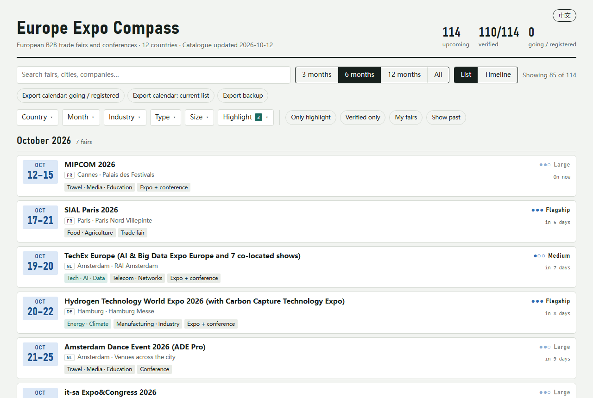

# Europe Expo Compass

English · [中文](README.zh-CN.md)

A local, offline browser for European B2B trade fairs and industry conferences: filter by country, month,
industry, type and size, see them on a timeline, keep your own status and notes per fair, and export your
plans to a calendar. Every date in the catalogue was checked on the organiser's or venue's own website.



The interface is available in English and Chinese (switch in the top-right corner).

## Features

- **Catalogue**: 114 fairs and conferences in 12 countries (NL, BE, DE, FR, GB, ES, IT, CH, AT, DK, SE, FI),
  October 2026 – October 2027, 16 industries. Snapshot of 2026-10-12.
- **Filters**: country, month, industry, type, size, a 3 / 6 / 12-month / all time range, and quick toggles
  (highlighted industries, verified only, my fairs, show past). Every option shows how many fairs it would leave.
- **Two views**: a month-by-month list and a timeline.
- **Your plans**: status (interested / going / registered / attended / skip), priority and networking notes per
  fair. Notes from earlier editions of the same fair are shown next to the current one.
- **Calendar**: an "add to Google Calendar" link per fair, and `.ics` export of your going / registered fairs or
  of the current list.
- **English / Chinese**: the whole interface and every fair description in both languages. The first visit
  follows the browser language; your choice is remembered. Search finds fairs by English or Chinese words.
- **Offline and private**: runs on `127.0.0.1` only; your data stays in one JSON file on your computer, with a
  daily backup.
- **Update check**: a script opens every fair's official page and reports dates that may have changed and next
  editions that have been announced.

## Quick start (Windows)

Requirements: Python 3.9+ (standard library only) and Microsoft Edge.

```bat
git clone https://github.com/FreeyaFly/europe-expo-compass.git
cd europe-expo-compass
python tools\update_catalog.py --apply
```

The last command loads the catalogue into your local data file (`data\expo.json`). Then double-click
**`Start Expo Compass.bat`**: it starts the local server and opens the app in an Edge app window.

On macOS or Linux: run `python3 tools/update_catalog.py --apply`, then `python3 server.py` and open
<http://127.0.0.1:8766/> in a browser.

## Keeping the catalogue current

| Step | Command | What it does |
|---|---|---|
| Check | double-click `Check for Updates.bat` or `python tools/check_updates.py` | Opens each fair's official page, checks the stored dates are still there, looks for next editions, writes `reports/check-<date>.md`. Changes nothing. |
| Update | `git pull`, then `python tools/update_catalog.py` | Shows what changed in `catalog/fairs.json` (added / changed / removed). |
| Apply | `python tools/update_catalog.py --apply` | Merges the catalogue into your data. Your status, notes and settings are never touched. |

Some sites refuse automated requests; the report lists them so you can open them by hand.
The command-line tools currently print their messages in Chinese.

## How the catalogue is built

- **Inclusion**: international fairs (AUMA / UFI listed or with many foreign exhibitors), fairs with 100+
  exhibitors or 5,000+ visitors, and recognised flagship conferences. Consumer fairs are not included.
- **Verification**: aggregator sites (10times, AUMA, tradefairdates, …) are used only to discover fairs. A fair is
  marked *verified* after its dates were read on the official site; `sourceUrl` points to that page. Fairs whose
  official site could not be reached are marked *aggregator only* in the app.
- **Size**: Flagship (1,000+ exhibitors or 50,000+ visitors), Large (300–1,000 / 10,000–50,000),
  Medium (100–300 / 5,000–10,000) and Boutique (small but senior audience). Where the official site gives no
  figures, the tier is an estimate and is shown lighter.

Each fair is one record in [`catalog/fairs.json`](catalog/fairs.json). Main fields: `id` (never changes),
`name`, `start`, `end`, `city`, `country`, `venue`, `url`, `industries`, `type`, `scale`, `scaleBasis`,
`exhibitors`, `visitors`, `ticket`, `highlight`, `verify`, `verifiedAt`, `sourceUrl`, `series`, `cycle`,
`eventStatus`, `deadlines`, and `en` (English versions of every Chinese text field; `update_catalog.py` refuses a
catalogue where one is missing).

## Project layout

```
server.py              local server (127.0.0.1:8766), data in data/expo.json, daily backups
src/expo-compass.html  the page
src/local-store.js     the page's data layer, backed by server.py
tools/build.py         builds app/index.html from src/
tools/update_catalog.py   validates catalog/fairs.json and merges it into your data
tools/check_updates.py    checks the catalogue against official websites
tools/import_backup.py    restores your status / notes from an exported backup
tests/                 end-to-end test (headless Edge) and offline tests for the date check
catalog/fairs.json     the fair catalogue
```

After changing `src/`, run `python tools/build.py` and `python tests/test_local.py`.

## Corrections

Dates and venues change. If you find a mistake or a missing fair, open an issue or a pull request with a link to
the official page that shows the correct information.

## Disclaimer

This project is not affiliated with any of the fairs, organisers or venues listed. Always confirm dates, venues
and admission rules on the official website before travelling or buying tickets.

## License

- Code: [MIT](LICENSE)
- Fair catalogue (`catalog/fairs.json`): [CC BY 4.0](LICENSE-DATA)
