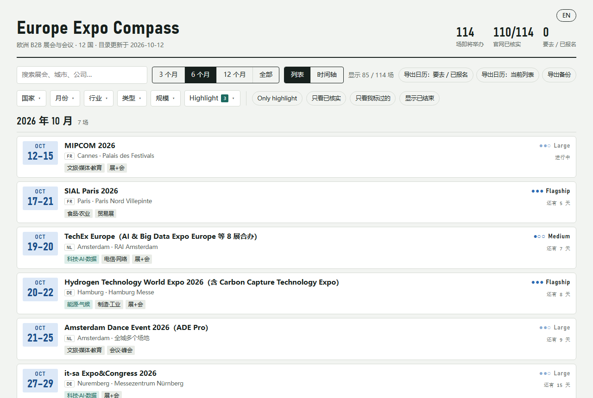

# Europe Expo Compass

[English](README.md) · 中文

一个在本机离线运行的欧洲 B2B 展会与行业会议浏览器：可以按国家、月份、行业、类型、规模筛选，用时间轴查看，
给每个展会记录自己的状态和笔记，并把计划导出到日历。目录里的每个日期都在主办方或场馆的官网上核实过。



界面支持中文和英文，右上角一键切换。

## 功能

- **展会目录**：12 个国家（荷兰、比利时、德国、法国、英国、西班牙、意大利、瑞士、奥地利、丹麦、瑞典、芬兰）的
  114 场展会和会议，时间从 2026 年 10 月到 2027 年 10 月，覆盖 16 个行业。数据截至 2026-10-12。
- **筛选**：国家、月份、行业、类型、规模，时间范围（3 个月 / 6 个月 / 12 个月 / 全部），以及快捷开关
  （只看 Highlight 行业、只看已核实、只看我标过的、显示已结束）。每个选项都会显示选了之后剩几场。
- **两种视图**：按月分组的列表，和时间轴。
- **我的计划**：每场展会可以标状态（感兴趣 / 要去 / 已报名 / 已去过 / 不去）、优先级，写 networking 笔记。
  同一个展会往届的笔记会显示在本届旁边。
- **日历**：每场都有「加到 Google 日历」链接；还可以把「要去 / 已报名」的展会或当前列表导出成 `.ics` 文件。
- **中英文**：整个界面和每场展会的说明都有中英两种语言。第一次打开时跟随浏览器语言，之后记住你的选择。
  搜索时中文、英文关键词都能搜到。
- **离线、私密**：只在 `127.0.0.1` 上运行；你的数据保存在电脑上的一个 JSON 文件里，每天自动备份。
- **更新检查**：一个脚本会逐个打开展会官网，报告日期可能有变的展会和已经公布的下一届。

## 快速开始（Windows）

需要：Python 3.9 以上（只用标准库）和 Microsoft Edge。

```bat
git clone https://github.com/FreeyaFly/europe-expo-compass.git
cd europe-expo-compass
python tools\update_catalog.py --apply
```

最后一条命令把展会目录写进你本地的数据文件（`data\expo.json`）。然后双击 **`Start Expo Compass.bat`**：
它会启动本地程序，并用 Edge 打开应用窗口。

macOS 或 Linux：运行 `python3 tools/update_catalog.py --apply`，再运行 `python3 server.py`，然后在浏览器里打开
<http://127.0.0.1:8766/>。

## 保持目录更新

| 步骤 | 命令 | 作用 |
|---|---|---|
| 检查 | 双击 `Check for Updates.bat`，或运行 `python tools/check_updates.py` | 逐个打开展会官网，核对登记的日期还在不在，查找下一届，生成 `reports/check-<日期>.md`。不改任何数据。 |
| 更新 | `git pull`，然后 `python tools/update_catalog.py` | 列出 `catalog/fairs.json` 里新增、修改、删除了哪些展会。 |
| 执行 | `python tools/update_catalog.py --apply` | 把目录合并进你的数据。你的状态、笔记和设置永远不会被改动。 |

有些网站会拒绝脚本访问，报告里会列出它们的链接，手动打开看就行。
命令行工具的提示和报告也有中英两种语言：默认跟随你在页面上选的语言，其次跟随系统语言，也可以用 `--lang zh` / `--lang en` 指定。

## 目录是怎么整理的

- **收录标准**：国际性展会（AUMA / UFI 收录，或外国展商比例高）、展商 100 家以上或观众 5,000 人以上的展会，
  以及行业公认的旗舰会议。不收录面向消费者的展会。
- **核实规则**：聚合网站（10times、AUMA、tradefairdates 等）只用来发现展会。只有在官网上读到日期之后，
  才标为「已核实」；`sourceUrl` 指向那个官网页面。官网打不开的展会，在应用里标为「仅见于聚合站」。
- **规模**：Flagship（展商 1,000+ 或观众 50,000+）、Large（300–1,000 / 10,000–50,000）、
  Medium（100–300 / 5,000–10,000）、Boutique（人数少但参会者层级高）。官网没给数字的，档位是估计的，显示成浅色。

每场展会是 [`catalog/fairs.json`](catalog/fairs.json) 里的一条记录。主要字段：`id`（永不更改）、`name`、
`start`、`end`、`city`、`country`、`venue`、`url`、`industries`、`type`、`scale`、`scaleBasis`、`exhibitors`、
`visitors`、`ticket`、`highlight`、`verify`、`verifiedAt`、`sourceUrl`、`series`、`cycle`、`eventStatus`、
`deadlines`，以及 `en`（所有中文文字的英文版本；缺了英文，`update_catalog.py` 会拒绝导入）。

## 项目结构

```
server.py              本地程序（127.0.0.1:8766），数据在 data/expo.json，每天自动备份
src/expo-compass.html  页面
src/local-store.js     页面的数据层，读写都通过 server.py
tools/build.py         由 src/ 生成 app/index.html
tools/update_catalog.py   校验 catalog/fairs.json 并合并进你的数据
tools/check_updates.py    对照官网检查展会目录
tools/import_backup.py    从导出的备份恢复你的状态和笔记
tests/                 端到端测试（无头 Edge）、日期识别和工具语言的离线测试
catalog/fairs.json     展会目录
```

改了 `src/` 之后，运行 `python tools/build.py` 和 `python tests/test_local.py`。

## 纠错

展会的日期和场馆会变。如果发现错误或漏掉的展会，欢迎提 issue 或 pull request，并附上能证明正确信息的官网链接。

## 免责声明

本项目与列出的任何展会、主办方或场馆都没有关联。出行或购票前，请务必在官网上确认日期、场馆和入场规则。

## 许可证

- 代码：[MIT](LICENSE)
- 展会目录（`catalog/fairs.json`）：[CC BY 4.0](LICENSE-DATA)
